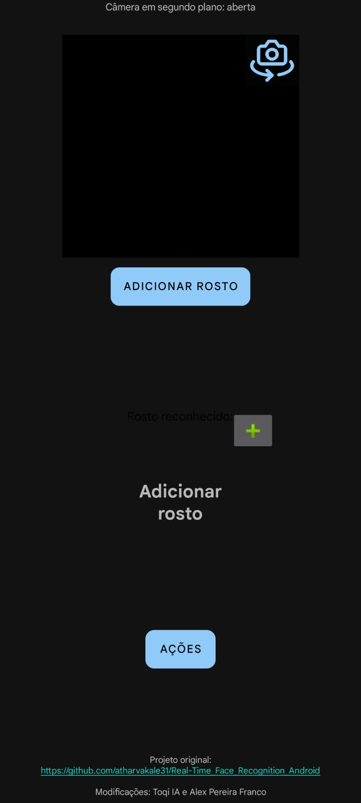
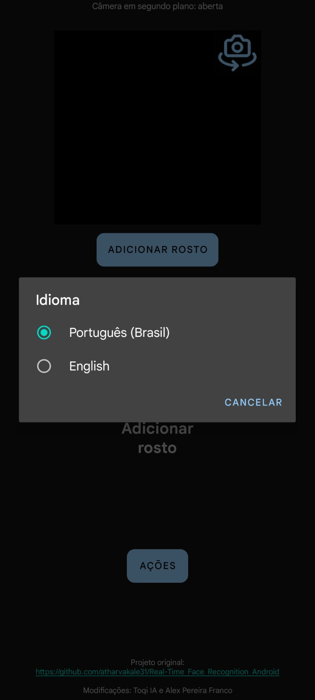
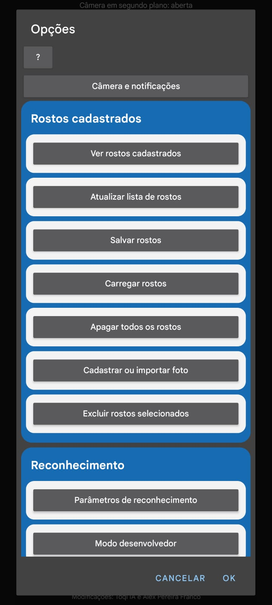
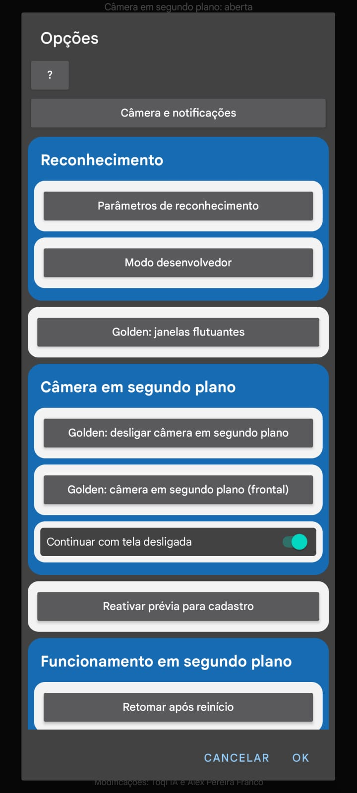
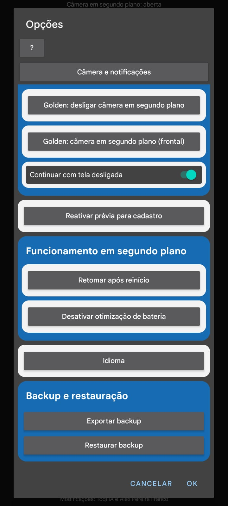
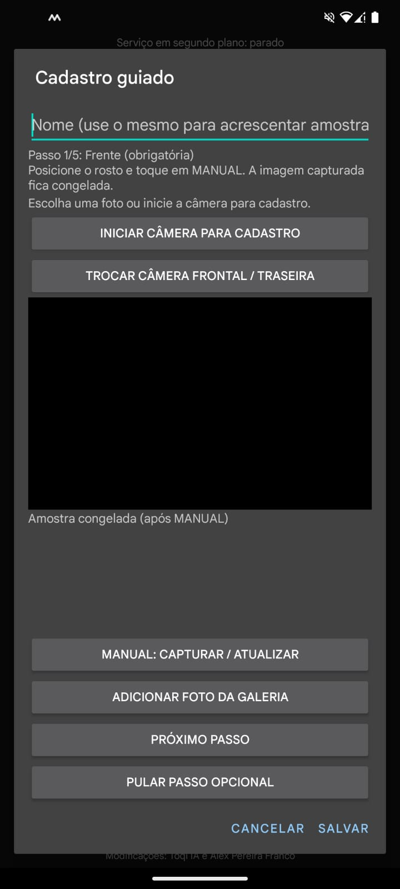

# Golden Face Recognitions

Golden Face Recognitions é uma adaptação Android de reconhecimento facial local, criada para integrar rostos cadastrados à Golden e permitir automações com o MacroDroid. É uma versão modificada do projeto [Real-Time Face Recognition Android](https://github.com/atharvakale31/Real-Time_Face_Recognition_Android), não um aplicativo criado do zero.

> **Projeto em preparação:** há um APK debug em [pré-release pública](https://github.com/NinoNinja13/Golden-Face-Recognition/releases/tag/GoldenFaceRecognitions) e [código reconstruído](codigo-reconstruido/) disponível para inspeção. A equivalência do código ao APK não foi comprovada; a reconstrução não é um projeto completo nem tem compilação validada.

## O que a variante integrada oferece

- Cadastro e reconhecimento de rostos no aparelho, com nome associado ao cadastro.
- Interface de câmera, opções de idioma e opção de exibir nomes em janela flutuante; essa opção depende da permissão de sobreposição.
- Câmera em segundo plano e notificações com o nome reconhecido, sujeitas às permissões e ao comportamento do Android.
- Integração com automações por meio das notificações. Veja exemplos em [MacroDroid](docs/MACRODROID.md).
- Exportação e restauração experimental em JSON de cadastros e preferências selecionadas. A restauração deve ser testada no aparelho antes de se depender dela.

A proposta é processar o reconhecimento localmente. A disponibilidade offline em todas as combinações de aparelho e dependências ainda precisa ser verificada. Restrições de câmera, notificações e segundo plano variam conforme o Android.

## Capturas de tela

Capturas reais da interface da variante integrada em revisão:

**Tela principal** — acesso à câmera e ao cadastro de rostos.

**Idioma** — seleção entre português brasileiro e inglês.

**Opções** — controles de cadastros e reconhecimento.

**Câmera em segundo plano** — opções de câmera e funcionamento em segundo plano.

**Backup e restauração** — opções para exportar e restaurar backup.

**Cadastro guiado** — tela de cadastro guiado de rosto.

## Instalação e compilação

O [APK debug está disponível na pré-release pública](https://github.com/NinoNinja13/Golden-Face-Recognition/releases/tag/GoldenFaceRecognitions). O [código reconstruído](codigo-reconstruido/) está disponível para inspeção, mas não é uma árvore Android completa e sua equivalência ao APK não foi comprovada. Faltam o modelo, imagens PNG e `gradle/wrapper/gradle-wrapper.jar`; não há procedimento de compilação validado.

A reconstrução privada consultada usa Java 11 no workflow, Gradle 7.3.3, Android Gradle Plugin 7.2.2, `compileSdk` 33, `minSdk` 21, `targetSdk` 33 e build-tools 30.0.3. Essas informações descrevem a reconstrução, **não** uma receita de build validada para este repositório. Compilação, instalação e funcionamento de uma distribuição limpa ainda precisam ser testados.

O código espera o modelo `app/src/main/assets/mobile_face_net.tflite`. A procedência e os termos de redistribuição dos pesos ainda estão em revisão, portanto não há modelo disponibilizado aqui. Sem um modelo compatível, o reconhecimento não funciona; o comportamento da aplicação sem o arquivo também não foi validado em todos os caminhos. A compatibilidade real de qualquer substituto precisa ser verificada, inclusive com cadastros existentes.

## Cadastros e backup

Na variante revisada, o backup experimental contém nomes, vetores de reconhecimento e grupos de preferências, não as fotos originais nem as permissões do Android. Ele **não é criptografado**. Ao restaurar, os dados da variante são substituídos após confirmação; desligue a câmera em segundo plano antes da restauração e mantenha uma cópia separada do arquivo. A restauração em dispositivo e o reconhecimento após importar ainda precisam de validação completa. Instalações com IDs de pacote diferentes não compartilham automaticamente seus dados.

## Projeto original e créditos

- **Projeto original:** [Real-Time Face Recognition Android](https://github.com/atharvakale31/Real-Time_Face_Recognition_Android), de **Atharva Kale e colaboradores**. [Colaboradores](https://github.com/atharvakale31/Real-Time_Face_Recognition_Android/graphs/contributors).
- **Golden Face — ideias, orientação e testes:** Alex Pereira Franco.
- **Golden Face — modificações:** Toqi, inteligência artificial, em colaboração com Alex.
- **Referências do projeto original para o modelo:** [artigo MobileFaceNets](https://arxiv.org/abs/1804.07573) e [MobileFaceNet_TF](https://github.com/sirius-ai/MobileFaceNet_TF). Essas referências não estabelecem, por si só, a origem ou a licença dos pesos usados pelo aplicativo.

Atharva autorizou a publicação da versão modificada com os créditos apropriados. Isso não define automaticamente uma licença geral para o código nem os direitos de distribuição dos pesos e de outros componentes. Os termos aplicáveis e avisos de terceiros ainda estão em revisão; nenhuma licença geral é presumida neste repositório.
